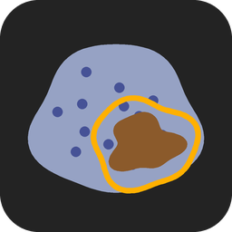

# Stainless



Desktop GUI for the **stained area of brightfield whole-slide scans** (Zeiss CZI): drop the
scans, draw the regions to measure (an infarct, a border zone, remote tissue), and get the
% of tissue stained in each section and region — one rule shared by the sections, which a
section can override when its staining calls for it — with a view that shows, live and at
full detail, what the rule calls stained.

Two stains:
- **DAB** immunohistochemistry with a **hematoxylin** counterstain (brown on blue);
- **SA-β-gal** (X-Gal, blue-green) without counterstain.

Made on Axio Scan.Z1 scans (Plan-Apochromat 20×/0.8 and 10×/0.45); any brightfield RGB CZI
mosaic is read.

## Install (Windows)

No admin rights, no PATH or registry changes, nothing written into your user profile.

1. On the GitHub page: **Code ▸ Download ZIP**.
2. **Right-click the ZIP ▸ Properties ▸ tick *Unblock* ▸ OK** — without it, SmartScreen stops
   the launcher with *"Windows protected your PC"*.
3. Extract it where it can stay (`C:\Users\Public\Stainless` serves every account).
4. Double-click **`Stainless.bat`**. The first time it downloads
   [`uv`](https://github.com/astral-sh/uv), Python 3.13 and the libraries (a few hundred MB, a
   minute or two) into the shared folder `C:\ProgramData\PyApps`, which other tools installed
   this way reuse, and puts a **Stainless** shortcut on the Desktop. Use the shortcut from then
   on; to pin it, right-click its taskbar button while it runs ▸ *Pin to taskbar*.

Self-contained instead: run **`Stainless.bat private`** the first time, and everything goes
into `C:\Users\Public\Stainless` (`STAINLESS_RUNTIME` picks another place).
**`uninstall.bat`** removes it: the whole private folder, or only Stainless's part of the
shared one. Python 3.13, not newer: the CZI reader (pylibCZIrw) has no newer build.

What Stainless remembers (the last folder, your region names) is in `stainless_options.json`
beside `Stainless.bat`; an internal error's details, in `stainless_errors.log` there (send it
along with a problem report).

## Use

**Drop CZI scans or folders anywhere on the window**, or **Add scans…** (Ctrl+I). Each scene
of a file is a section. Slide previews and snapshots (coarser than 2 µm/px) are left out,
with a line in the log. Hover anything for what it does; the log at the bottom says what
happened and what looks wrong (✗ ⚠).

1. **Sections** — the list on the left, with each section's thumbnail and the slide's label as
   the scanner photographed it. Give each a *name*, a *group* (what the figure compares) and
   a *role*: sample, negative control, positive control, or left out. A file named
   "…neg…" or "…posit…" starts as a control.
   - **Stain**: DAB or SA-β-gal.
   - **Stained when**: the rule (below), shared by every section. **Zoom in** (mouse wheel)
     and the view reads the scan in detail and colours, live, what the rule calls stained;
     move the sliders and it follows. The line under the view gives the % in view.
     A section stained more strongly, or with more background, can have **its own rule**:
     switch on *this section only*, and the sliders set that section's alone (*Reset* puts
     it back on the shared rule). The list marks it *own rule*; the results give every row's
     threshold and say *own* or *shared*.
   - **Resolution**: the scan's own pixels, ½ (2 × 2 averaged, the default) or ¼.
   - **Regions**: pick a name, **Draw** (D), and trace around the area with the left button
     held. Draw as many as needed; each is reported apart, the whole section always. A region
     named **exclude** takes its area out of the tissue everywhere (folds, debris, bubbles).
     Click a region to select it; double-click its name in the list to rename; Del removes.
   - **Measure**: *This section*, or *All* — every section not measured yet, or measured with
     other settings or regions (Ctrl+M). Stop keeps what is finished. A section measured with
     other settings than the current ones says so (in orange in the results).
2. **Results** — a row per section and region: tissue mm², stained mm², % stained, mean OD of
   the stained pixels. The figure shows one region: a dot per section, mean ± SD per group,
   controls apart in grey. **Copy** (Ctrl+C), **Export…** (Ctrl+E: `.xlsx` with the
   experiment and the settings, or `.csv`), **Save figure…** (PNG, SVG, PDF).
3. **Experiment** — what was done: title, operator, tissue, antibody, dilution, detection,
   chromogen, counterstain…; below, the settings it was measured with and what each scan says
   about itself (scanner, objective, date).

**Save** (Ctrl+S) writes the experiment as one `.json`: the sections (with paths relative to
it, so a folder moved with its scans opens the same), regions, record, settings and results,
maps included. **Open…** (Ctrl+O) or drop it on the window. Ctrl+Z / Ctrl+Y undo and redo.

## How it measures

Each pixel's absorbance (optical density, OD) is taken against **the section's own glass**,
measured on the slide (the brightest fifth of the scanned area), not against pure white: the
scanner's glass is grey-green (RGB ≈ 160, 162, 160), and an OD taken against 255 would carry
that tint into every pixel.

- **Tissue**: summed OD (R + G + B) ≥ 0.15, inside the section's outline (pieces under
  0.02 mm² are dust), minus the regions named *exclude*.
- **Stained**: the absorbance **points toward the stain** — hue score ≥ the threshold — and is
  **dense enough** to be stain — summed OD ≥ the minimum. The hue score is (OD · w) / ΣOD:
  which way the absorbance points, independent of how much there is. For DAB, w = blue − red:
  brown absorbs blue more than red, hematoxylin the other way round, unstained grey tissue
  neither (0). For SA-β-gal, w = red − blue.
- **% stained** = stained px / tissue px × 100, in the whole section and in each region.

Defaults, each set on real slides:
- **DAB**: hue ≥ 0.03, summed OD ≥ 0.20, tissue OD ≥ 0.15 — on the VCAM-1 MI slides, the
  negative control section reads 0.2 % of its tissue positive.
- **SA-β-gal**: hue ≥ 0.35, summed OD ≥ 0.08; without counterstain the unstained tissue is
  barely darker than the glass, so the whole outline is tissue (outline: smoothed OD ≥ 0.01).
  On 13 sections of mouse A549 tumours it ranks them as the earlier SA-β-gal pipeline did
  (Spearman 0.97, same median), in 7 s per section instead of ~5 min.

Why not colour deconvolution's DAB channel: on the VCAM-1 slides it measures darkness as
much as brownness, so the negative control's dark folds and nuclei force its threshold up. At
the threshold leaving 0.5 % of the control's infarct positive, the DAB channel found 1.3–2.5 %
of the stained infarct, the hue score 9–11 %.

Why a shared threshold, not one computed per section: a threshold computed from each
section's own pixels adapts to its staining, so a control and a treated section are not
measured with the same ruler, and a negative section always yields "positives". Where a
section really differs, its own rule is a deliberate, recorded choice.

Why ½ by default: at the scan's own pixels the camera's pixel noise passes the hue test —
the MI-21 negative control reads +66 %, a 10× scan up to 14 times more in one region — while
½ gives the same numbers as the scan's pixels smoothed by ~2 px, in a quarter of the time.
The scan's own pixels stay one click away.

## Dev

```bash
uv sync                                    # or the launcher, once
uv run python -m stainless                 # the GUI
uv run python -m stainless.analysis        # each module with logic has a self-check
uv run python misc/smoke_test.py [CZI]     # the whole window, headless (QT_QPA_PLATFORM=offscreen)
python misc/bump.py                        # stamp today's date as the version, before committing
python misc/make_icon.py                   # redraw the icon
```

`analysis.py` (the measurement, no Qt) · `czi.py` (scenes, reads, label) · `model.py` (the
experiment, its .json, exports) · `viewer.py` (the slide view) · `plot.py` (the figure) ·
`app.py` (the window). Version: CalVer `YYYY.M.D`, the date the shipping code last changed.
